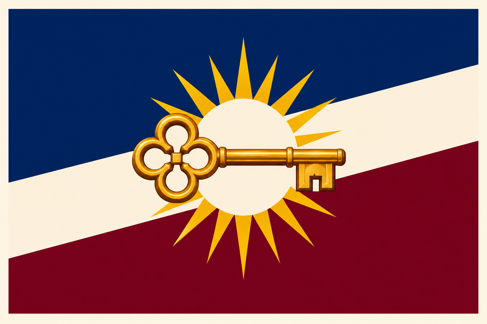

# Флаг Киенлока

Статус: утверждённый визуальный концепт для лора. Пока не интегрирован в игровые сцены.

## Описание

Прямоугольное знамя с пропорциями **3:2**. Тёмно-синее поле в верхней левой части и тёмно-красное поле в нижней правой части уравновешены по площади; между ними проходит широкая светлая диагональная полоса. Композиция полей симметрична относительно центра.

В середине — **золотой ключ**, направленный вправо, на фоне **золотых солнечных лучей**. Ключ имеет характерную четырёхлепестковую головку. Дополнительного орнамента и декоративной каймы нет.

## Официальная символика

- **Ключ** — власть обещает открыть каждому жителю путь к безопасности, достатку и счастью.
- **Солнце** — образ просвещённого и благополучного будущего, которое государство обещает построить.
- **Синий** — порядок, постоянство и защищённость.
- **Красный** — единство жителей и общая ответственность за процветание.
- **Светлая диагональ** — мир и общий путь, соединяющий разные части общества.
- **Золото** — достаток и достоинство страны.

Симметрия синего и красного подчёркивает в официальной трактовке равновесие **порядка** и **заботы** под единым государственным ключом.

## Место в мире игры

Флаг служит узнаваемым официальным символом власти Киенлока. Его смысл связан с государственной риторикой **«Мы сделаем вас счастливыми»**: благополучие жителей преподносится как главная цель решений правительства.

В оформлении мира этот символ может появляться на государственных зданиях, документах, агитационных плакатах и во время публичных церемоний. Такое использование — **направление для будущих игровых сцен**, а не утверждение, что эти объекты уже добавлены в игру.

Нарративный подтекст: обещание «ключа к счастью» может звучать двусмысленно, когда игрок сталкивается с государственной цензурой и контролем. Официальное объяснение флага при этом остаётся оптимистичным и благожелательным.

## Файл и ограничения

- Основной файл: [`assets/branding/keynlock-flag.png`](../../assets/branding/keynlock-flag.png) — PNG, 1536 × 1024.
- При дальнейших адаптациях сохранять **равные синий и красный сегменты**, широкую светлую диагональ и центральные ключ с солнцем.
- Не добавлять народные узоры, растения, животных или архитектурные символы.
